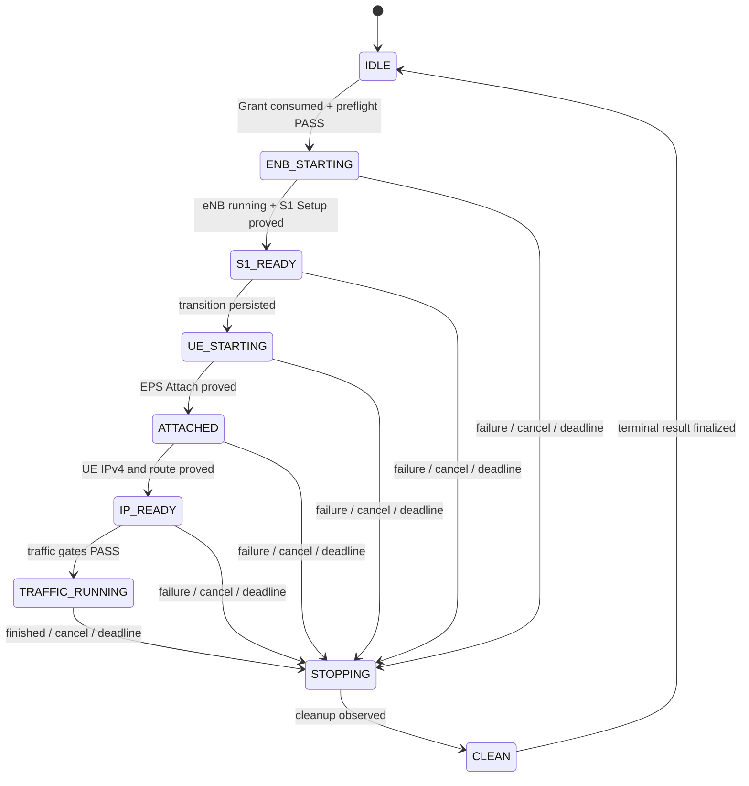

# ANR1 — LTE orchestration contract V2

Mission: `OIRAN_POLARIS_LTE_E2E_COMPLETION_V2`

Base: `671282b6e4b540722f82f896d2a95aece924fc51`

Profile: `LTE-SRSUE-TEST-01`

Scenario: `lte-e2e-certification-v1`

Status: `CONTRACT_READY / LIVE_BLOCKED`

This contract extends `polaris.live-grant.v2` and
`oiran-polaris.lte-e2e-evidence.v1`. It authorizes no live action or
deployment.

## State machine

State and outcome are separate. A `CLEAN` run has outcome `COMPLETED`,
`FAILED`, `CANCELLED`, or `RECOVERY_BLOCKED`. Every error goes through
`STOPPING`. `CLEAN` is written only after all cleanup observations pass;
otherwise the durable state remains `STOPPING` with `cleanup_required=true`.

Before each external side effect POLARIS atomically persists the intended
transition and operation ID. It persists the bounded observation afterwards.
A durable per-profile lease permits one non-terminal run. Same idempotency key
returns the same run; a different key returns `409 LTE_RUN_ALREADY_ACTIVE`.

## Deadlines and retries

The hard deadline is the earlier of Grant expiry or 300 seconds after run
creation. Phase deadlines are clipped to remaining time.

| Phase | Limit | Attempts | Failure |
|---|---:|---:|---|
| Preflight | 15 s | 1 | `LTE_PREFLIGHT_FAILED` |
| eNB start | 30 s total | 2 | `LTE_ENB_START_FAILED` |
| S1 ready | 40 s | 1 | `LTE_S1_SETUP_TIMEOUT` |
| UE start | 30 s total | 2 | `LTE_UE_START_FAILED` |
| Attach | 45 s | 1 | `LTE_ATTACH_TIMEOUT` |
| UE IP | 20 s | 1 | `LTE_IP_TIMEOUT` |
| Ping + UDP | 60 s total | 1 | `LTE_TRAFFIC_FAILED` |
| Cleanup | 45 s total | 2 | `LTE_CLEANUP_FAILED` |

Poll once per second. A start retry is legal only when the exact allowlisted
target is observed stopped and no ownership/digest drift exists. Traffic is
never retried. Cleanup is idempotent and targets only run-owned sidecars,
srsUE, then srsENB.

## Grant V2 and recovery

- Ownership is durably `POLARIS_CONTROLLER`; maximum active LTE UEs is one.
- Administrator + CSRF controls the profile. Operator + CSRF issues/revokes
  grants and starts/stops runs. Viewer is read-only.
- Issuance and run creation use distinct idempotency keys. Nonce and keys are
  persisted only as SHA-256.
- Consumption is atomic and bound to profile/configuration and
  scenario/revision digests. It is allowed once.
- Expiry before consumption rejects. Expiry or revocation during a run sets
  `cancel_requested`; the next state boundary enters `STOPPING` and no new
  traffic starts.
- Stop/cleanup is grant-independent after expiry, revocation or restart.
- Restart never resumes traffic. A recovered non-terminal run enters
  `STOPPING`; cleanup yields `CLEAN` or `RECOVERY_BLOCKED`.

Stores require atomic replacement, checksum verification, mode 0600 and
fail-closed corruption handling. Audit stores role, method, route, result,
run/grant pseudonyms and timestamp, never secrets, nonce or tokens.

## Canonical runtime ownership

Every runtime operation verifies:

1. Compose project `oiran-lab` and exact compose path.
2. Exact services `srsenb` and `srsue`, never an HTTP runtime target.
3. Compose project/service labels.
4. Pinned image ID
   `sha256:69e094349657cc6a062ce3717661d6b8a553a23ce571f821e33256beec753d43`.
5. Profile revision plus configuration and Compose-model digests.

The existing digest is
`SHA256(path_utf8 || 0x00 || file_bytes || 0x00 ...)` over the ordered
allowlist: protected UE config, eNB config, RR config, Compose file and
versions file. V2 adds `compose_model_sha256`, calculated from fixed-argv
`docker compose config --format json`, parsed and serialized with sorted JSON
object keys. The rendered model is never logged or returned. Both hashes must
match before start and traffic. Runtime commands use fixed argv and timeout;
shell evaluation, arbitrary containers and adoption are forbidden.

## Resource gates

Before Grant consumption and before traffic:

- root disk usage is strictly below 85%;
- `/proc/meminfo` `MemAvailable` is at least 4,294,967,296 bytes;
- exactly 12 external `dumpcap` processes exist;
- EPC health, ownership and both digests pass;
- no other LTE run or srsUE is active.

Low RAM returns `503 LTE_MEMORY_RESERVE_NOT_MET` with observed/required byte
counts and starts nothing. If it falls below reserve later, no traffic starts
and the run enters `STOPPING`. Dumpcaps are read-only observations and never
signalled.

## Mandatory evidence

Evidence is append-only and bounded. Raw log lines are not stored. Every
observation has source kind/hash or packet reference, monotonic sequence, UTC
timestamp, validity and sanitized classification.

| State | Required proof |
|---|---|
| `ENB_STARTING` | exact owned eNB running; image/config digests match |
| `S1_READY` | sanitized S1 Setup success plus SCTP association |
| `UE_STARTING` | exact owned UE running; subject digests match |
| `ATTACHED` | sanitized EPS Attach success plus EPC context, no identity |
| `IP_READY` | non-loopback IPv4 on exact UE data interface and route proof |
| `TRAFFIC_RUNNING` | fixed destination/interface, command hash and bounds |
| Traffic complete | sent/received packets and bytes, exit status, duration |
| `CLEAN` | UE/eNB stopped, sidecars absent, EPC healthy, 12 dumpcaps present |

Scenario bounds: one UE, five minutes; ping maximum five packets per
direction; UDP one stream at maximum 1,000,000 bit/s for 10 seconds per
direction, payload at most 1,200 bytes. Destinations are fixed allowlist
entries, never supplied by the request.

## OIRAN handoff

The canonical manifest remains `oiran-polaris.lte-e2e-evidence.v1`.
Mandatory canonical planes are `S1_MME`, `S11`, `S1_U`; decoder aliases are
`S1-MME`, `S11`, `S1-U`. Unknown optional planes are rejected explicitly,
not ignored. Each evidence reference must resolve to one capture reference.
Capture references must be unique by plane and require SHA-256, frame bounds,
decoder/schema version and sanitization state; `first_frame <= last_frame`.

Only `SANITIZED_APPROVED` evidence may enter public Session Explorer or Call
Flow. Required correlations are S1AP/NAS by pseudonymized S1 context,
S1AP E-RAB↔S11 by explicit unique bearer/tunnel evidence, and S11↔S1-U by
unique TEID plus endpoint roles and capture scope. Timestamp proximity alone
never creates an edge; ambiguity remains `UNKNOWN`.

An anonymized export is a separate artifact and never overwrites raw PCAP. Its
manifest includes source/output hashes, transformation version,
removed/replaced field classes, packet count and review state. Export starts
`SANITIZED_PENDING_REVIEW`; ANR1 review alone promotes it to
`SANITIZED_APPROVED`.

## Offline acceptance

ANR2 covers success, timeouts, retry bounds, cancellation, expiry/revocation,
replay, duplicate launch, restart recovery, store corruption, ownership and
digest drift, low RAM, disk/dumpcap mismatch and cleanup failure with mocks.

ANR3 covers schema adaptation, plane aliases, resolved references, required
planes, hash mismatch, atomic/idempotent ingestion, conflict/rollback,
S1AP/GTPv2-C/GTP-U, reused TEID rejection, multi-UE isolation, streaming,
pagination, anonymized export and 5G regressions with synthetic fixtures.

`CONTRACT = READY`

`RAM_GATE_AT_PUBLICATION = PASS`

`DISK_GATE_AT_PUBLICATION = PASS`

`LIVE = BLOCKED`

`DEPLOYMENT = BLOCKED`

— **ANR1**
