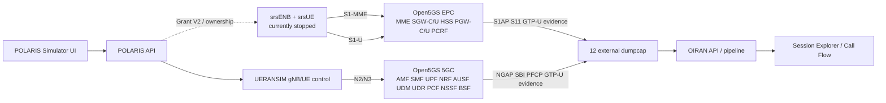

# OIRAN / POLARIS — Final integration certification V1

Date: 2026-10-31 UTC

Integration branch: `integ/oiran-polaris-final-v1`

Integrated source checkpoint: `8c33fa6d77a9ea2abb4ea541d999477ddb3e6788`

## Verdict

`OFFLINE_INTEGRATION = PASS`

`PRODUCTION_DEPLOYMENT = NOT_EXECUTED`

`LTE_REAL_CERTIFICATION = BLOCKED`

`FINAL_STATUS = PARTIAL`

The offline LTE/5G integration is committed and tested. It is not a real LTE
certification: no LTE grant was issued, no srsENB/srsUE was started, no traffic
was generated and no production component was deployed. The candidate remains
fail-closed until the runtime orchestration and real sanitized evidence gates
are closed.

## Integrated sources

| Component | Source | Version/status |
|---|---|---|
| ANR1 certification gates | `95d5732564f1d6ffe15c0f4b487c01dd4aeca4c6` | tooling 1.0.0 |
| POLARIS Grant V2 | `14e7a29232187a924cc65b21f2ae1329f83065c6` | API 0.22.0 / Simulator 0.15.0 |
| OIRAN LTE pipeline | `2c67fe6b2cbb450fefaa789c76f947678388953c` | oiran-decode 0.6.0 / Analyzer 2.6.0-pre.1 |
| Integrated source | `8c33fa6d77a9ea2abb4ea541d999477ddb3e6788` | all three ancestors verified |

The integration initially exposed a semantic merge regression: the divergent
history restored a hard-coded probe identifier and omitted the frontend leak
scanner. The integration gate rejected that build. The final integration uses
the exact tested OIRAN subtree from `2c67fe6`; the hard-coded value is absent
and `check-dist-leaks` passes.

## Real laboratory architecture



The LTE candidate does not yet cross the dashed runtime edge: Grant V2 is
persistent and secured, but the state machine after `ENB_STARTING` does not yet
perform bounded S1 wait, UE start, Attach/IP, ping/UDP and evidence publication.

## Measured host and production state

Commands executed read-only at `2026-10-31T16:38:02Z`:

```bash
nproc
free -h
df -h /
pgrep -x dumpcap | wc -l
docker ps --format '{{.Names}}|{{.Status}}'
curl http://127.0.0.1:49153/api/v1/version
curl http://127.0.0.1:49153/api/v1/ues
curl http://127.0.0.1:49152/api/v1/version
```

| Measurement | Result |
|---|---|
| Logical CPUs | 10 |
| RAM | 19 GiB total; 2.5 GiB available during final builds |
| Root disk | 387 GiB total, 294 GiB used, 93 GiB free, 77% |
| External dumpcap | 12 |
| Healthy Open5GS NFs | 17 |
| UERANSIM gNB | 1 healthy |
| POLARIS configured UE profiles | 2 |
| Running / registered / active PDU | 0 / 0 / 0 |
| Deployed POLARIS API | 0.19.8, unchanged |
| Deployed OIRAN API | 2.5.4, unchanged |

Disk is below 85%, but available RAM was below the ANR1 conservative 4 GiB
reserve during the final build window. The live preflight therefore remains
blocked until resources are remeasured in a clean window.

## Protocol coverage

| Domain | Offline coverage | Real certification |
|---|---|---|
| LTE S1-MME | S1AP + NAS EPS routing, Attach/E-RAB procedure classification | blocked: no approved real PCAP |
| LTE S11 | GTPv2-C Create/Modify/Delete Session, EBI/F-TEID | blocked: no approved real PCAP |
| LTE S1-U | GTP-U TEID, direction, UL/DL packet and byte counters | blocked: no approved real PCAP |
| LTE correlation | S1AP↔S11 and S11↔S1-U with explicit IDs/TEID/scope | synthetic PASS; real blocked |
| 5G N2/N3/N4/SBI | existing NGAP/NAS/PFCP/GTP-U/SBI paths preserved | no new live run performed |
| Session/Call Flow | deterministic LTE session, bearer and provenance model | synthetic PASS; real blocked |

No timestamp-only correlation is accepted. A TEID match proves a tunnel, not
subscriber identity.

## Tests executed manually

### Integrated POLARIS

```bash
CARGO_BUILD_JOBS=1 cargo test --offline -p polaris-control-api --lib
cd apps/simulator-control
npm ci --ignore-scripts
npm run typecheck
npm run test
npm run build
npm audit --omit=dev --json
```

Results: API `205 passed / 0 failed / 3 ignored manual`; frontend `35 files /
215 tests passed`; typecheck and production build PASS; production dependency
audit reports zero vulnerabilities. The ANR2 source branch additionally passed
the Rust workspace (`250 passed`) and six LTE Playwright tests.

### Integrated OIRAN

```bash
cargo test --offline -p decoder-s1ap -p decoder-gtpv2c -p decoder-gtpu \
  -p oiran-decode -p session-engine -p correlation-engine -p callflow-schema
cargo test --offline -p oiran-api
cd OIRAN/apps/web
npm run typecheck
npm run test
npm run build
```

Results: LTE/5G Rust pipeline `66 passed`; OIRAN API `33 passed`; Analyzer
`10 files / 73 tests passed`; typecheck, build (`1,636 modules`) and the
distribution identity/fixture leak scan PASS. Four synthetic LTE JSON fixtures
validate and the long numeric identity scan returns zero matches.

### ANR1 safety gates

The positive deterministic preflight returns `READY`; forced disk violation
returns `BLOCKED`; unavailable decoder returns `BLOCKED|DECODER_UNAVAILABLE`.
The release gate validates candidates but intentionally does not transform raw
PCAPs.

## Gate decision

| Gate | Status | Evidence/reason |
|---|---|---|
| 1 — code and offline tests | PASS | integrated Rust/API/frontend suites pass |
| 2 — Grant V2 and LTE ownership | PARTIAL | security/store/ownership pass offline; complete runtime orchestration missing |
| 3 — security and isolation | PARTIAL | allowlists, RBAC, CSRF, anti-replay and fail-closed flags pass; real isolation not exercised |
| 4 — explicit LTE live authorization | BLOCKED | not provided |
| 5 — LTE E2E | BLOCKED | Gates 2–4 incomplete |
| 6 — real anonymized LTE PCAP | BLOCKED | no authorized live source; no raw-to-sanitized transformer |
| 7 — OIRAN LTE REAL_PASS | BLOCKED | synthetic evidence only |
| 8 — deployment authorization | BLOCKED | not provided |
| 9 — controlled deployment | NOT EXECUTED | prohibited by current gate state |

## Confirmed defects and next actions

1. Implement the asynchronous LTE run state machine after `ENB_STARTING`,
   including bounded S1, Attach/IP, ping/UDP, timeout cleanup and evidence refs.
2. Add offline orchestration tests for timeout, partial startup, restart,
   revocation, cleanup and exact target ownership.
3. Repeat the ANR1 preflight in a clean resource window. Only then may the
   operator issue a separate five-minute grant for `LTE-SRSUE-TEST-01`.
4. If LTE E2E succeeds, keep raw PCAP protected, create an anonymized candidate,
   pass the release gate and validate E-RAB/TEID correlation on real encoding.
5. Request a separate deployment authorization only after Gates 2–7 pass.

`OPEN5GS_CHANGED = FALSE`

`UERANSIM_CHANGED = FALSE`

`PRODUCTION_CHANGED = FALSE`

`LIVE_EXECUTED = FALSE`

`DUMPCAP_INTERRUPTED = FALSE`

— **ANR1**
